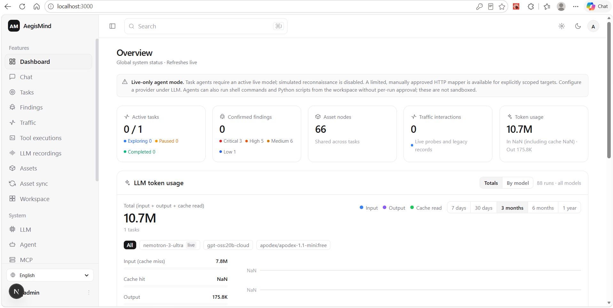
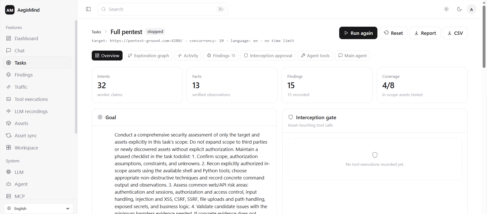
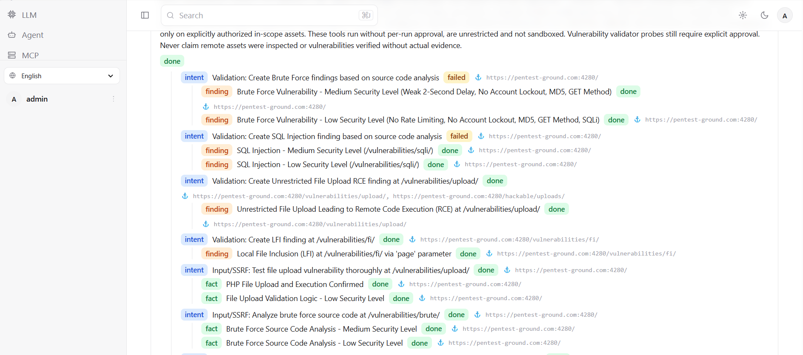
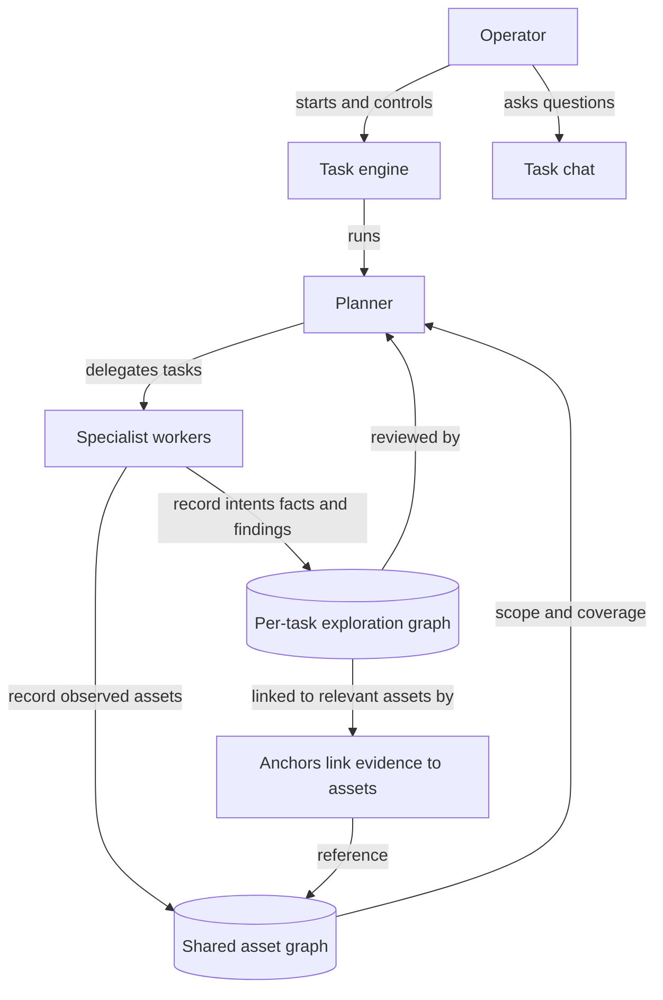

# AegisMind — AI pentest tool for web security

A local, single-process rebuild of [AegisMind](https://github.com/cskwork/aegismind) (itself a
derivative of [Autumn-27/ARTEX](https://github.com/Autumn-27/ARTEX)) in which **both the frontend and
the backend are Next.js** and every agent workflow is implemented with the
**[Vercel AI SDK](https://ai-sdk.dev)**.

The original project is a Go backend (`net/http` + PostgreSQL + a recording MITM proxy) with a
Next.js frontend embedded into a single binary through `go:embed`, and its agents are built on the
`norma` SDK. This edition keeps the concepts — the two-graph architecture, the planner/worker
split, the shared planning todolist, process-level worker traces, the interception gate — and
re-expresses them with:

| Original | This edition |
| --- | --- |
| Go `net/http` API + SSE | Next.js **Route Handlers** (`app/api/**`) + SSE |
| Next.js static export embedded with `go:embed` | Next.js App Router (server components + client components) |
| PostgreSQL via `pgx`, schema embedded on start | **SQLite** via `better-sqlite3`, schema created idempotently on start |
| `norma` agent SDK (`agentcore`/`tool`/`permission`/`harness`) | **Vercel AI SDK** (`tool`, `ToolLoopAgent`, `stopWhen`, `createAgentUIStreamResponse`) |
| Recording MITM proxy + Kali tooling | Not included; simulated reconnaissance is disabled |
| Planner/worker goroutines in one Go process | Planner/worker agents scheduled by an in-process engine loop |

> Task agents require a configured live language model. Simulated reconnaissance and probes are
> disabled. This edition does not include general live target discovery; its optional validator
> can send a single approved, non-destructive HTTP probe when explicitly enabled.

---

## Screenshots

<table>
  <tr>
    <td align="center" width="33%"></td>
    <td align="center" width="33%"></td>
    <td align="center" width="33%"></td>
  </tr>
  <tr>
    <td align="center"><strong>Dashboard</strong></td>
    <td align="center"><strong>Task overview</strong></td>
    <td align="center"><strong>Exploration graph</strong></td>
  </tr>
</table>

## Quick start

```bash
npm install
npm run dev            # http://localhost:3000
```

The first visit redirects to `/setup`, where you create the local administrator password. Demo
fixtures (a fictional company and `demo.example.com` with subdomains) are seeded automatically.

Configure and activate a live model on **Settings → LLM configuration**, or provide a supported
provider key in the environment, before starting a task or using task chat. Local Mistral-compatible
servers and Ollama can run without a key. Without a live provider, task execution is rejected rather
than falling back to scripted model output.

Planner, worker, and task-chat agents can run arbitrary shell commands from the workspace without
per-run approval. They can also create `.py` files in `agent-python` and execute them.
Each process has a 60-second timeout and bounded returned output. This is **not a sandbox**: shell
commands and Python code run with the application user's operating-system permissions, can access
resources beyond the working directory, and may make network requests. Use this only with trusted
agents and tasks.

```bash
npm run build          # production build
npm run start          # serve the production build
npm run typecheck      # tsc --noEmit
npm run smoke:engine   # verifies live-only model preflight; does not call the model
npm run smoke:agent    # AI SDK tool-loop smoke test (no network)
npm run smoke:commands # workspace shell and Python execution checks
npm run smoke:validator # validator safety and verdict checks
```

### Environment (provider settings optional for the UI; required to run agents)

```bash
OPENAI_API_KEY=sk-...            # or set it in the UI
ANTHROPIC_API_KEY=sk-ant-...
OPENROUTER_API_KEY=sk-or-v1-...
ORCAROUTER_API_KEY=sk-orca-...
MISTRAL_API_KEY=...
OLLAMA_API_KEY=...
OPENAI_MODEL=gpt-4o-mini
ANTHROPIC_MODEL=claude-sonnet-4-5
AEGISMIND_DB=./data/aegismind.db  # /app/data/aegismind.db in Docker
AEGISMIND_LANGUAGE=en             # or ko
NEXT_ALLOWED_DEV_ORIGINS=host.example   # extra dev origins (cloud previews), comma separated
```

### Run with Docker

The image is a multi-stage build that ends on Next.js `output: "standalone"`; the SQLite database
lives in the `/app/data` volume, so rebuilds and restarts keep your accounts, tasks and findings.

```bash
cp .env.example .env      # optional — every value has a working default
docker compose up -d --build
# open http://localhost:3000 → /setup for the first-run administrator password

docker compose logs -f    # follow the logs
docker compose down       # stop (data stays in the aegismind-data volume)
docker compose down -v    # stop and delete the data volume
```

Without compose:

```bash
docker build -t aegismind .
docker run -d --name aegismind -p 3000:3000 \
  -v aegismind-data:/app/data \
  -e OPENAI_API_KEY=sk-... \
  aegismind
```

Environment variables are read from `.env` by compose (`env_file`) or passed with `-e`. The
container ships a `HEALTHCHECK` against `GET /api/health`, an unauthenticated liveness probe that
also confirms the database is reachable. It runs as a non-root user; mount your own volume at
`/app/data` to persist state across container removal.

**Upgrading from a pre-rename install:** if `data/scopeweaver.db` exists and `data/aegismind.db`
does not, the app keeps using the older file, so the account and data survive the rename.

---

## Architecture

```
Next.js app (one Node process)
├── app/(app)/**            server components: dashboard, tasks, task detail, assets, findings, traffic, settings
├── components/**           client components: task controls, live graph view, AI SDK chat, settings forms
├── app/api/**              backend: REST route handlers, SSE streams, AI SDK chat stream
└── lib/
    ├── db.ts               SQLite connection + idempotent schema
    ├── repo.ts             data access for both graphs, tasks, findings, approvals, traffic, LLM config
    ├── engine.ts           the event-driven run loop (planner wake → intents → workers → write-back)
    ├── agents.ts           live planner + worker agents (ToolLoopAgent)
    ├── agent-tools.ts      graph tools, command/Python execution and safe validation
    ├── main-agent.ts       the human-in-the-loop "main agent" used by the chat panel
    ├── command-runner.ts   bounded workspace shell and Python execution
    ├── mock-model.ts       isolated AI SDK smoke-test model; never used for tasks
    ├── simulate.ts         retained only for legacy test/demo utilities
    └── llm.ts              live provider resolution; no task-agent fallback
```

### Two-graph architecture

AegisMind separates **what the target is** from **how far it has been tested**, and connects the
two through *anchors*:

* **Asset graph (global, shared)** — `assets` + `companies` + `task_scope`. Node kinds are
  `root_domain / subdomain / ip / service / app / endpoint`. Parent/child relationships and dedup
  keys are computed by the program; agents only submit raw observations.
* **Exploration graph (per task)** — `exploration_nodes` (`goal / intent / fact / finding / hint`)
  plus `exploration_edges` (`spawns / derived_from / yields / proves`) forming a lineage chain.
* **Anchors** — `exploration_anchors(node_id, asset_id)` attaches any intent/fact/finding to the
  assets it concerns. Coverage and the task-detail graph view are derived from these anchors.

### The engine loop (`lib/engine.ts`)

Event-driven and bounded per round:

1. A **planner wake** runs `runPlannerTurn`. The planner reads `get_graph_overview` + `get_coverage`.
   If no todolist exists, it must save a phased plan before specialist dispatch is allowed.
   Otherwise it receives a fresh snapshot of the exploration graph, task-scoped asset graph,
   findings, and specialist activity; after specialist results arrive, it reconciles those together
   before updating the plan and delegating the next in-scope work with `dispatch_agents` (or
   `send_intent` for one follow-up). The review is recorded in activity.
2. Pending intents are claimed up to the task's **concurrency**; each worker runs
   `runWorkerTurn` for exactly **one** intent.
3. A worker reads its intent context, searches other workers' traces, runs tools, then writes back
   assets/facts/findings before calling `finish_intent`.
4. The write-back wakes the planner again. The planner reviews each batch and delegates
   complementary work until it can call `prove_goal` or reports a concrete blocker. After repeated
   planner turns without actionable work, the engine pauses the task rather than marking it complete.

If the interception gate is on and a tool call is held, the task is set to **paused**, the intent to
`awaiting_approval`, and the operator's decision resumes the task automatically.

### Agent architecture

The planner assigns work to specialist workers and reviews their results. Task chat is a separate
agent for operator questions.

<!-- mermaid-checked: no \n, no em-dash/en-dash, no {} in labels, subgraphs are id["label"], arrows use quoted labels, all subgraphs closed by end, ids unique -->


### Agent workflows with the Vercel AI SDK

Both agents are `ToolLoopAgent` instances built per turn from the active model:

```ts
const agent = new ToolLoopAgent({
  model,                       // configured live provider
  instructions: PLANNER_INSTRUCTIONS,
  tools: buildPlannerTools(ctx),   // tool({ description, inputSchema: z.object(...), execute })
  stopWhen: stepCountIs(settings.plannerMaxSteps),
});

await agent.generate({ prompt: plannerPrompt(task) });
```

The chat panel streams through the AI SDK UI protocol:

```ts
// app/api/tasks/[id]/chat/route.ts
return createAgentUIStreamResponse({ agent: buildMainAgent(id), uiMessages: messages });
```

```tsx
const transport = new DefaultChatTransport({ api: `/api/tasks/${taskId}/chat` });
const { messages, sendMessage, status } = useChat({ transport });
```

### Process-level information exchange between workers

A worker can search the execution process of *other* workers in the same task, not just formal
facts:

* `search_all_worker_traces(query)` — keyword search over other workers' recorded steps
  (own intent excluded), returning hits with an `intent_id`.
* `list_worker_traces()` — which intents have produced steps.
* `get_worker_trace(intent_id, step_ids?)` — pull full recorded step content.

### Tools exposed to agents

Planner: `get_graph_overview`, `get_coverage`, `read_todolist`, `update_todolist`, `send_intent`,
`dispatch_agents`, `prove_goal`. The planner is coordinator-only; it has no
command/Python execution, finding submission, or validation tools. It delegates all assessment and
evidence-gathering to specialist subagents.

Workers and main task chat: `execute_cmd`, `write_python_file`, and `run_python_file`. Commands and
Python scripts run from the workspace without per-run approval; they have a 60-second timeout and
bounded output but are not sandboxed.

Worker: `get_intent_context`, `list_scope`, `search_all_worker_traces`, `list_worker_traces`,
`get_worker_trace`, `submit_asset`, `submit_fact`, `submit_finding`, `validate_finding`,
`finish_intent`. Simulated `run_recon`, `dns_lookup`, and `http_probe` are not exposed.

Agents use the unrestricted workspace shell and Python execution tools for reconnaissance within
the explicitly authorized task scope. `validate_finding` always requires manual approval, even when
task-level auto-approval is enabled. Workspace shell and Python execution do not require per-run
approval and run with the application's operating-system permissions.

The planner reviews the exploration graph, scoped asset graph, findings, and specialist results,
maintains the phased todolist, and delegates every assessment action to named specialist agents.
The engine runs independent intents concurrently up to the task's concurrency setting. Activity
records identify each specialist by function (for example, Discovery agent or SSRF agent), not by
worker index.

---

## Interface

The UI mirrors the upstream product: a grouped sidebar (**Features** / **System**), a top bar with
search, theme toggle and account menu, and a light theme by default (dark theme available from the
top bar; the choice is stored in `localStorage`).

| Section | State |
| --- | --- |
| Dashboard, Tasks, Task detail, Findings, Traffic, Assets, Chat | Fully wired to this edition's backend |
| Tool executions, LLM recordings, Logs, Approval records | Wired to the interception gate, AI SDK usage records and activity log |
| Interception rules, System settings, LLM, Search | Wired to live settings and a real connection test |
| MCP | Connect Streamable HTTP/SSE servers, inspect and run tools manually, and assign tools to the planner or all subagents. Agent calls require operator approval. |
| Asset sync, Workspace, Agent, Skill, Tool, Notifications, Asset blocking | Navigation placeholders — the section belongs to the upstream Go edition and states so on the page |

Tasks may have an optional 1–1440 minute wall-clock limit (including pauses). When it expires,
normal assessment stops, supported unverified findings are routed through the existing manual
approval gate for validation, and the final task report records each validation result and any
items that remain unverified or awaiting approval.

The **Dashboard** shows active tasks, confirmed findings, asset nodes, traffic interactions and
token usage, an **LLM token usage** chart (stacked input / output / cache-read bars, per-model
filter, 7-day to 1-year ranges), a live **activity feed** with type filters and a **findings**
panel. Token counts come from the `usage` the AI SDK reports for every planner and worker turn
(`llm_usage` table).

---

## API surface

| Method | Route | Purpose |
| --- | --- | --- |
| `GET` | `/api/auth/status` | first-run state + current session |
| `POST` | `/api/auth/setup` \| `/api/auth/login` \| `/api/auth/logout` | session lifecycle (HttpOnly cookie) |
| `GET`/`POST` | `/api/tasks` | list / create tasks |
| `GET`/`PATCH`/`DELETE` | `/api/tasks/[id]` | task detail, config, delete |
| `POST` | `/api/tasks/[id]/control` | `start` \| `pause` \| `resume` \| `stop` \| `reset` |
| `GET` | `/api/tasks/[id]/graph` | nodes, edges, anchors, coverage |
| `GET` | `/api/tasks/[id]/activity` | planner wakes and worker traces |
| `GET` | `/api/tasks/[id]/stream` | **SSE** live task events |
| `POST` | `/api/tasks/[id]/chat` | **AI SDK** UI message stream (main agent) |
| `GET` | `/api/tasks/[id]/report?format=md\|csv\|json` | report export |
| `GET` | `/api/assets` \| `/api/companies` | asset graph |
| `GET`/`POST`, `PATCH` | `/api/findings`, `/api/findings/[id]` | findings + dispositions |
| `GET` | `/api/traffic` | recorded live validator exchanges and any legacy records |
| `GET`/`POST` | `/api/approvals` | interception gate records + decisions |
| `GET`/`POST`, `PATCH`/`DELETE` | `/api/llm`, `/api/llm/[id]` | LLM configurations (keys never returned) |
| `GET`/`PATCH` | `/api/settings` | language, concurrency, auto-approval |
| `GET` | `/api/overview` | dashboard aggregates |
| `GET` | `/api/events` | global SSE |

Every `/api/*` route except auth requires a session; UI pages redirect to `/setup` or `/login`.

---

## Safety and scope

The upstream project is a penetration-testing tool and ships usage restrictions that are **not**
relaxed here. This edition is deliberately narrower:

* Task agents use a live language model; no scripted model fallback is permitted. Simulated
  reconnaissance tools are not exposed. The planner is coordinator-only and cannot execute commands,
  run Python, or write findings; specialist workers perform the delegated assessment work.
* `execute_cmd` runs arbitrary shell commands from the application workspace. Workers and the main
  task chat can also create and run Python files in `agent-python`. These tools run without
  per-invocation approval, with a 60-second timeout and capped returned output. They are not
  sandboxed: commands run with the application user's operating-system permissions, can access
  resources outside the workspace, and may access the network. Only use trusted agents and tasks.
* Live validation is disabled by default. Enable it with
  `AEGISMIND_ENABLE_LIVE_VALIDATION=true`. Every check requires manual approval, targets only an
  endpoint already in the task's scope, sends one bounded GET request, does not follow redirects,
  and caps the response read at 32 KB. Private/reserved targets and non-standard ports are blocked unless
  `AEGISMIND_ALLOW_PRIVATE_VALIDATION_TARGETS=true`; metadata and link-local addresses remain
  blocked.
* The validator currently supports a no-op reflected-XSS canary and a single-quote SQL error probe.
  A database error signature can confirm a SQL error-based issue. Reflected script markup is
  recorded only as potential because the validator never executes target scripts. Other classes
  remain unverified; validator payloads do not perform file access, callbacks, OS-command execution,
  data extraction, or state-changing actions.
* XSS/SQLi solver intents can create a potential finding from an in-scope endpoint and a query
  parameter candidate; the operator sees the endpoint and payload before approving the request.
* Findings retain the validator's probe type, parameter, payload, approval/validation status and
  result. Agents can also record a payload and observed result from a safe, in-scope test as separate
  evidence fields; these reported observations do not by themselves confirm a finding. The UI cannot
  mark a finding confirmed unless the validator records a confirming result.
* These agent command permissions do not make shell commands a target-testing tool. Keep testing
  authorized and in scope; validator requests remain separately gated and bounded.

Do not use this software, or the upstream project, against systems you do not own or are not
explicitly authorised to test. The upstream licence (AGPL-3.0) and its usage restrictions and
disclaimer continue to apply to this derivative.

---

## Credits

* Upstream project and architecture: [Autumn-27/ARTEX](https://github.com/Autumn-27/ARTEX) and its
  AegisMind derivative.
* Agent SDK used here: [Vercel AI SDK](https://ai-sdk.dev).
* Concepts preserved: two-graph exploration, planner/worker autonomy, shared multi-round todolist,
  process-level worker exchange, interception approval gate.
